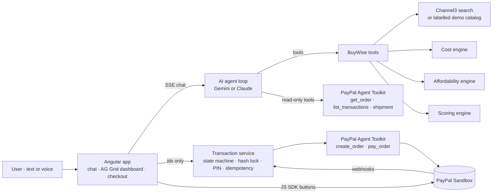

# BuyWise AI

**Tell it what you want to achieve. It works out what you actually need, what it will really cost over the first year, and once you approve the exact purchase, PayPal executes it.**

Most shopping assistants answer the question you asked ("which PS5?"). BuyWise answers the one you should have asked: *what's the best way to reach my goal, and what will it really cost?*

```
Goal → discover solutions → hidden requirements → true first-year cost → budget fit → ranked recommendation
     → user approves a locked plan → PIN authorization → PayPal order (server-side) → buyer approval → capture
```

Built for the PayPal AI Hackathon 2026.

---

## What it does

> "I want to get into gaming. I earn $2,000 a month."

1. **Understands the goal, not the product.** The AI agent records the goal, experience and the budget figures the user chose to share.
2. **Discovers solutions across categories:** consoles, gaming PCs, handhelds. It doesn't stop at the product the user named.
3. **Finds the hidden requirements** for each solution and labels each one REQUIRED, RECOMMENDED or OPTIONAL: games, subscriptions, a second controller.
4. **Checks bundles.** The engine compares a bundle against buying its parts separately, and only uses the bundle if it is actually cheaper.
5. **Calculates the true first-year cost** in deterministic code: upfront plus 12 months of subscriptions. The LLM never does arithmetic.
6. **Assesses budget impact** in neutral terms (for example "0.28× the monthly income you shared"). It never says "you can't afford this".
7. **Ranks options with a reproducible scoring engine:** cost 30%, goal fit 30%, budget fit 20%, bundle value 10%, availability 10%. The agent then explains the ranking.
8. **Lets the user decide.** They can toggle accessories in the AG Grid dashboard, pick any option, and ask "why not PlayStation?"
9. **Runs a PayPal checkout the AI cannot touch.** The plan is locked with a SHA-256 hash, authorized with a PIN the AI never sees, created as a PayPal order on the server, approved by the buyer, then captured.

## Architecture



### The key design decision: the AI can plan purchases but never move money

| | AI agent (Gemini / Claude) | Transaction service (backend) |
|---|---|---|
| Search products, build options, rank | ✅ | |
| Prepare a **draft** purchase plan | ✅ | |
| Look up PayPal orders / transactions / tracking | ✅ (read-only toolkit) | |
| Lock plan, verify PIN | ❌ not in its toolset | ✅ |
| Create / capture PayPal order | ❌ not in its toolset | ✅ (execution toolkit) |

There are **two separate PayPal Agent Toolkit instances** with different action allow-lists (`backend/src/paypal/toolkit.ts`). The one given to the AI agent can only *read*. The money-moving actions belong to a second instance that only the transaction service holds, and only after a hash-verified, PIN-authorized plan. The restriction is structural, not a prompt instruction.

### Transaction state machine

```
DRAFT → FINAL_REVIEW → LOCKED → AUTHORIZED → PAYMENT_PENDING → PAYMENT_SUCCESS
                          ↘ AUTHORIZATION_FAILED     ↘ PAYMENT_FAILED / PAYMENT_DECLINED / SYSTEM_ERROR
```

- **Lock:** at lock time, prices are re-checked against the catalog. If anything moved, the plan goes back to the user, so every decision happens before authorization. The financial payload is serialized as canonical JSON and hashed with SHA-256.
- **Authorize:** the PIN is checked against a salted scrypt hash with a constant-time compare. Wrong PINs are rate-limited, and the plan is cancelled after 3 attempts. The PIN is never logged, stored, persisted or sent to the AI.
- **Order:** the PayPal order is created server-side from the locked plan. The amount PayPal returns is checked against the locked total to the cent.
- **Capture:** idempotent per order. A duplicate capture request returns the existing result instead of charging twice. Authorization expires after 10 minutes.
- **No negotiation after the PIN:** a declined payment ends in `PAYMENT_DECLINED`. The agent never proposes an alternative after authorization.
- **No client-side amounts:** the purchase endpoints accept only ids. Totals come from the cost engine.

## How each technology is used

**PayPal (central)**
- `@paypal/agent-toolkit`, read-only, exposed to the AI agent as tools: `get_order`, `list_transactions`, `get_shipment_tracking`. The agent can answer "did my order go through?" from real PayPal data.
- `@paypal/agent-toolkit`, execution: `create_order` (Orders v2, item-level breakdown) and `pay_order` (capture), called only by the transaction service.
- PayPal JS SDK Buttons for buyer approval. The browser only passes the server-created order id.
- Webhooks at `/api/webhooks/paypal`, verified with `verify-webhook-signature`, settle captures that complete asynchronously.

**AI agent: Google Gemini or Anthropic Claude**
- One provider-neutral tool registry (`backend/src/agent/tools.ts`) drives two manual function-calling loops: Gemini (`agent/gemini.ts`, default `gemini-2.5-flash`, thought signatures preserved) and Claude (`agent/orchestrator.ts`, `claude-opus-5-5` with adaptive thinking). Both stream to the UI over server-sent events (text deltas and tool activity).
- The provider is picked by whichever key is set (`GEMINI_API_KEY` or `ANTHROPIC_API_KEY`), or forced with `AI_PROVIDER`.
- Every tool input is validated with zod. Product ids must come from catalog results, so a made-up product is rejected.
- Server-side refusal fallback is enabled (`fallbacks: "default"`). The system prompt is frozen and cached.

**Channel3**
- `POST /v1/search` and `GET /v1/products/{id}` (`backend/src/catalog/channel3.ts`), normalized into one `Product` model with the best in-stock offer across retailers.
- Without `CHANNEL3_API_KEY`, BuyWise uses a bundled demo catalog. Every demo product is tagged `source: "demo-catalog"`, the header shows "Demo catalog", and the agent is told not to call these live prices.

**AG Grid**
- The comparison grid is the main decision screen: rank, upfront, monthly, first-year cost, gap to the cheapest option, bundle savings, budget-impact chip, and score bar. It uses a custom dark Quartz theme and links to the detail panel when a row is clicked.

**Render**
- `render.yaml` deploys one web service. The Node backend serves the built Angular app.

## Run it locally

Requires Node 20.19+ (Angular 21).

```bash
npm run install:all
cp backend/.env.example backend/.env    # then fill in keys
npm run dev:backend                      # http://localhost:3000
npm run dev:frontend                     # http://localhost:4200 (proxies /api)
```

### Keys

| Variable | Needed for | Where |
|---|---|---|
| `GEMINI_API_KEY` **or** `ANTHROPIC_API_KEY` | the agent | aistudio.google.com/apikey (free tier) or console.anthropic.com |
| `PAYPAL_CLIENT_ID`, `PAYPAL_CLIENT_SECRET` | checkout | developer.paypal.com → Apps & Credentials → **Sandbox** |
| `CHANNEL3_API_KEY` | live product data (optional) | trychannel3.com |
| `DEMO_PIN` | PIN authorization (default `2468`) | your choice |

**Testing a purchase:** use a **sandbox personal (buyer) account** from developer.paypal.com → Sandbox accounts to approve the payment in the PayPal pop-up. To test a decline, use PayPal's sandbox negative-testing options.

### Tests

```bash
npm test          # vitest: cost/affordability/scoring engines, lock, state machine, PIN, full purchase flow (PayPal mocked)
npm run typecheck
```

The tests cover: exact cent arithmetic, bundle detection, neutral affordability wording, deterministic ranking, made-up product ids rejected, PIN lockout, a plan tampered with after locking, a hash for different contents, a duplicate capture that charges only once, a declined payment, and an order id that belongs to another plan.

## Demo script (3 minutes)

1. "I want to get into gaming. I earn $2,000 a month." Watch the activity feed: searches across consoles, PC and handhelds, then options built and ranked.
2. The dashboard fills in: the recommended option, pay-today vs true first-year cost, budget impact, and the AG Grid comparison.
3. "Why not PlayStation?" The agent explains using engine numbers.
4. Untick an optional accessory. Totals and ranking update instantly.
5. "Let's buy it." Review the plan, **Lock** it (hash shown), enter the PIN, and the PayPal order is created on the server.
6. Approve in the PayPal sandbox window. The capture completes and shows a receipt with order id, capture id and lock hash.

## Project layout

```
backend/src
  agent/         orchestrator + Claude loop, Gemini loop, tools (zod-validated, provider-neutral), prompt
  catalog/       Channel3 client + mapper, labelled demo catalog
  engine/        cost, affordability, scoring - deterministic, unit-tested
  transactions/  state machine, canonical-JSON hash lock, service (lock/authorize/capture)
  security/      PIN verification (scrypt, attempts)
  paypal/        Agent Toolkit instances (read-only vs execution), orders
  routes/        REST + SSE API, PayPal webhooks
frontend/src/app
  chat/          streaming chat, voice in/out (Web Speech API)
  dashboard/     KPI tiles, AG Grid comparison, option detail
  checkout/      review → lock → secure PIN pad → PayPal buttons → receipt
```

## Limitations

- **Currency is USD.** The PayPal Agent Toolkit's `create_order` and Channel3 both support USD (Channel3 has no INR).
- **Shipping and tax are left to the retailer** and shown as "Calculated by retailer". Totals are item prices.
- **The PIN is a demo authorization boundary** that sits alongside PayPal's own buyer approval, not instead of it. In production it would be replaced by real step-up authentication.
- **Storage is a JSON file** (`backend/data/store.json`), behind a small store module so it can be swapped for PostgreSQL.
- **Subscriptions are costed into the first-year total but not purchased** here; they're billed by their providers.
- **The demo catalog** is representative pricing for offline judging, not live data.

## License

MIT - see [LICENSE](LICENSE).
