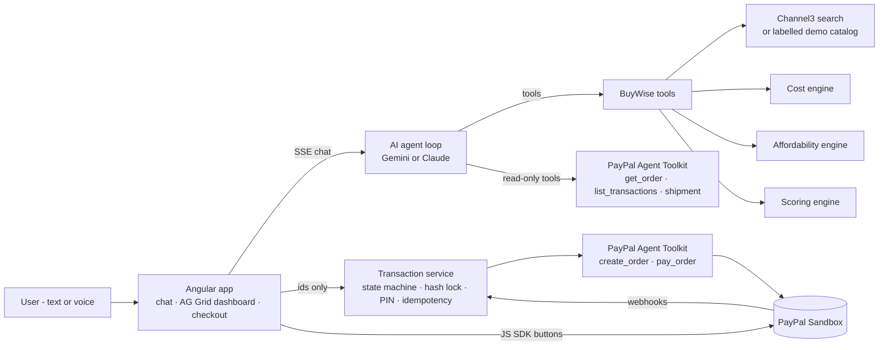

# BuyWise AI

**Tell it what you want to buy. It compares the best options - including ones you didn't think of - shows what each really costs over the first year, checks it against your salary in your own currency, and once you approve the exact purchase, PayPal executes it.**

Most shopping assistants just find the product you named. BuyWise answers the question you should have asked: *what's the best thing for me to buy, and what will it really cost?*

```
Sign in with PayPal → "I want a PS5" → agent asks salary (country comes from PayPal)
  → alternatives + what else you need → true first-year cost → salary fit → ranked recommendation
  → user locks the exact plan → own PIN → PayPal order (server-side) → buyer approval → capture
```

Built for the PayPal AI Hackathon 2026.

---

## What it does

> "I want a PS5" → *"Which country are you in, and roughly what's your monthly salary?"* → "India, ₹60,000"

0. **Sign in with PayPal** (or try as a guest). PayPal provides the user's name and country, and the user sets a private 4-digit BuyWise PIN that approves every purchase.
1. **Asks before it searches.** If the user only names a product, the agent asks for country and monthly salary (in their own currency) - once - then gets to work.
2. **Discovers alternatives:** iPhone vs Android vs refurbished, MacBook vs Windows vs Chromebook, PS5 vs Xbox vs handheld. It doesn't stop at the product the user named, but always includes it and marks it "You asked".
3. **Finds the hidden requirements** for each solution and labels each one REQUIRED, RECOMMENDED or OPTIONAL: games, subscriptions, a second controller.
4. **Checks bundles.** The engine compares a bundle against buying its parts separately, and only uses the bundle if it is actually cheaper.
5. **Calculates the true first-year cost** in deterministic code: upfront plus 12 months of subscriptions. The LLM never does arithmetic.
6. **Assesses budget impact** in neutral terms (for example "0.28× the monthly income you shared"). It never says "you can't afford this".
7. **Ranks options with a reproducible scoring engine:** cost 30%, goal fit 30%, budget fit 20%, bundle value 10%, availability 10%. The agent then explains the ranking.
8. **Lets the user decide.** A "You asked for X vs BuyWise recommends Y" card shows the difference in money; they can toggle items in the AG Grid dashboard, pick any option, and ask "why not PlayStation?"
   - **Local currency:** salary is accepted as stated (₹60,000) and converted at live ECB rates by the backend; every amount displays in the user's currency, while checkout shows the exact USD amount PayPal charges.
9. **Runs a PayPal checkout the AI cannot touch.** The plan is locked with a SHA-256 hash, authorized with a PIN the AI never sees, created as a PayPal order on the server, approved by the buyer, then captured.

## Architecture



### The key design decision: the AI can plan purchases but never move money

| | AI agent (Gemini / Claude) | Transaction service (backend) |
|---|---|---|
| Search products, build options, rank | ✅ | |
| Prepare a **draft** purchase plan | ✅ | |
| Look up PayPal orders / transactions / tracking | ✅ (read-only toolkit) | |
| Lock plan, verify PIN | ❌ not in its toolset | ✅ |
| Create / capture PayPal order | ❌ not in its toolset | ✅ (execution toolkit) |

There are **two separate PayPal Agent Toolkit instances** with different action allow-lists (`backend/src/paypal/toolkit.ts`). The one given to the AI agent can only *read*. The money-moving actions belong to a second instance that only the transaction service holds, and only after a hash-verified, PIN-authorized plan. The restriction is structural, not a prompt instruction.

### Transaction state machine

```
DRAFT → FINAL_REVIEW → LOCKED → AUTHORIZED → PAYMENT_PENDING → PAYMENT_SUCCESS
                          ↘ AUTHORIZATION_FAILED     ↘ PAYMENT_FAILED / PAYMENT_DECLINED / SYSTEM_ERROR
```

- **Lock:** at lock time, prices are re-checked against the catalog. If anything moved, the plan goes back to the user, so every decision happens before authorization. The financial payload is serialized as canonical JSON and hashed with SHA-256.
- **Authorize:** the PIN is checked against a salted scrypt hash with a constant-time compare. Wrong PINs are rate-limited, and the plan is cancelled after 3 attempts. The PIN is never logged, stored, persisted or sent to the AI.
- **Order:** the PayPal order is created server-side from the locked plan. The amount PayPal returns is checked against the locked total to the cent.
- **Capture:** idempotent per order. A duplicate capture request returns the existing result instead of charging twice. Authorization expires after 10 minutes.
- **No negotiation after the PIN:** a declined payment ends in `PAYMENT_DECLINED`. The agent never proposes an alternative after authorization.
- **No client-side amounts:** the purchase endpoints accept only ids. Totals come from the cost engine.

## How each technology is used

**PayPal (central)**
- `@paypal/agent-toolkit`, read-only, exposed to the AI agent as tools: `get_order`, `list_transactions`, `get_shipment_tracking`. The agent can answer "did my order go through?" from real PayPal data.
- `@paypal/agent-toolkit`, execution: `create_order` (Orders v2, item-level breakdown) and `pay_order` (capture), called only by the transaction service.
- PayPal JS SDK Buttons for buyer approval. The browser only passes the server-created order id.
- Webhooks at `/api/webhooks/paypal`, verified with `verify-webhook-signature`, settle captures that complete asynchronously.

**AI agent: Google Gemini or Anthropic Claude**
- One provider-neutral tool registry (`backend/src/agent/tools.ts`) drives two manual function-calling loops: Gemini (`agent/gemini.ts`, default `gemini-2.5-flash`, thought signatures preserved) and Claude (`agent/orchestrator.ts`, `claude-opus-5-5` with adaptive thinking). Both stream to the UI over server-sent events (text deltas and tool activity).
- The provider is picked by whichever key is set (`GEMINI_API_KEY` or `ANTHROPIC_API_KEY`), or forced with `AI_PROVIDER`.
- Every tool input is validated with zod. Product ids must come from catalog results, so a made-up product is rejected.
- Server-side refusal fallback is enabled (`fallbacks: "default"`). The system prompt is frozen and cached.

**Channel3**
- `POST /v1/search` and `GET /v1/products/{id}` (`backend/src/catalog/channel3.ts`), normalized into one `Product` model with the best in-stock offer across retailers.
- Without `CHANNEL3_API_KEY`, BuyWise uses a bundled demo catalog. Every demo product is tagged `source: "demo-catalog"`, the header shows "Demo catalog", and the agent is told not to call these live prices.

**AG Grid + AG Charts** (the decision interface)
- **Option comparison grid:** grouped column headers (Pay today / Ongoing / First year / Fit), pinned rank column, "You asked" badge, salary-impact chips with the ratio, score bars with a weighted-breakdown tooltip, row selection driving the rest of the dashboard, and **CSV export** in the user's currency. Custom dark Quartz theme via the Theming API.
- **"Everything you'd buy" grid:** every item across every option with option tabs (external filter), quick search, editable **Buy checkboxes** that call the backend cost engine and re-rank live, and a pinned **totals row** recomputed on every filter change.
- **AG Charts stacked bar chart:** first-year cost per option split into product, accessories, software and 12 months of subscriptions, in the user's currency.

**Log in with PayPal** (PayPal Identity, OAuth 2.0 authorization-code flow)
- `/api/auth/paypal/start` → PayPal consent (scopes `openid profile email address`) with a one-time `state` cookie against CSRF → `/api/auth/paypal/callback` exchanges the code, reads userinfo, then **discards the PayPal token**. We keep only name, email, country and a scrypt hash of the user's own PIN, behind an httpOnly session cookie.
- Conversations and plans are owned by the signed-in user (ownership checks on every session and plan endpoint).

**Abuse and cost protection for the public demo**
- Per-IP sliding-window rate limits on chat, sessions, plans and auth, plus a global `DAILY_AI_TURN_LIMIT` on AI conversations per day.

**Render**
- `render.yaml` deploys one web service. The Node backend serves the built Angular app.

## Run it locally

Requires Node 20.19+ (Angular 21).

```bash
npm run install:all
cp backend/.env.example backend/.env    # then fill in keys
npm run dev:backend                      # http://localhost:3000
npm run dev:frontend                     # http://localhost:4200 (proxies /api)
```

### Keys

| Variable | Needed for | Where |
|---|---|---|
| `GEMINI_API_KEY` **or** `ANTHROPIC_API_KEY` | the agent | aistudio.google.com/apikey (free tier) or console.anthropic.com |
| `PAYPAL_CLIENT_ID`, `PAYPAL_CLIENT_SECRET` | checkout | developer.paypal.com → Apps & Credentials → **Sandbox** |
| `CHANNEL3_API_KEY` | live product data (optional) | trychannel3.com |
| `DEMO_PIN` | PIN for **guest** checkout (default `2468`); signed-in users set their own | your choice |
| `PUBLIC_URL` | Log in with PayPal return URL base (default `http://localhost:4200`) | your app's public URL |
| `DAILY_AI_TURN_LIMIT` | max AI conversations per day (default 400) | your choice |

**Log in with PayPal setup:** developer.paypal.com → Apps & Credentials → **Sandbox** → your app → **Features** → enable **Log in with PayPal** → *Advanced settings*: tick **Full name**, **Email** and **Address**, and set the **Return URL** to `<PUBLIC_URL>/api/auth/paypal/callback` (locally `http://localhost:4200/api/auth/paypal/callback`). Judges can also skip sign-in with **Try as guest**.

**Testing a purchase:** use a **sandbox personal (buyer) account** from developer.paypal.com → Sandbox accounts to approve the payment in the PayPal pop-up. To test a decline, use PayPal's sandbox negative-testing options.

### Tests

```bash
npm test          # vitest: cost/affordability/scoring engines, lock, state machine, PIN, full purchase flow (PayPal mocked)
npm run typecheck
```

The tests cover: exact cent arithmetic, bundle detection, neutral affordability wording, deterministic ranking, made-up product ids rejected, PIN lockout, a plan tampered with after locking, a hash for different contents, a duplicate capture that charges only once, a declined payment, and an order id that belongs to another plan.

## Demo script (3 minutes)

1. **Continue with PayPal** → sign in with a sandbox account → create a 4-digit BuyWise PIN.
2. "I want a PS5." The agent asks only for salary (country came from PayPal) → "60,000 rupees a month".
3. Watch the live status ("Gemini … is working · Searching products …"), then the dashboard: recommendation, "You asked for PS5 vs BuyWise recommends …", ₹ amounts, AG Grid comparison and AG Charts year-one cost.
4. Untick an item in "Everything you'd buy" - totals and ranking update instantly.
5. "Let's buy it." Review → **Lock** (hash shown) → enter your PIN → PayPal order created server-side.
6. Approve in the PayPal sandbox window → capture → receipt with order id, capture id and lock hash.

A shot-by-shot recording script is in [docs/demo-video-script.md](docs/demo-video-script.md).

## Project layout

```
backend/src
  agent/         orchestrator + Claude loop, Gemini loop, tools (zod-validated, provider-neutral), prompt
  catalog/       Channel3 client + mapper, labelled demo catalog
  engine/        cost, affordability, scoring - deterministic, unit-tested
  transactions/  state machine, canonical-JSON hash lock, service (lock/authorize/capture)
  security/      PIN verification (scrypt, attempts)
  paypal/        Agent Toolkit instances (read-only vs execution), orders
  routes/        REST + SSE API, PayPal webhooks
frontend/src/app
  chat/          streaming chat, voice in/out (Web Speech API)
  dashboard/     KPI tiles, AG Grid comparison, option detail
  checkout/      review → lock → secure PIN pad → PayPal buttons → receipt
```

## Limitations

- **Payments settle in USD.** The PayPal Agent Toolkit's `create_order` and Channel3 support USD (Channel3 has no INR), so amounts are *displayed* in the user's currency but PayPal charges the exact USD total shown at checkout.
- **Shipping and tax are left to the retailer** and shown as "Calculated by retailer". Totals are item prices.
- **The PIN is a demo authorization boundary** that sits alongside PayPal's own buyer approval, not instead of it. In production it would be replaced by real step-up authentication.
- **Storage is a JSON file** (`backend/data/store.json`), behind a small store module so it can be swapped for PostgreSQL.
- **Subscriptions are costed into the first-year total but not purchased** here; they're billed by their providers.
- **The demo catalog** is representative pricing for offline judging, not live data.

## License

MIT - see [LICENSE](LICENSE).
